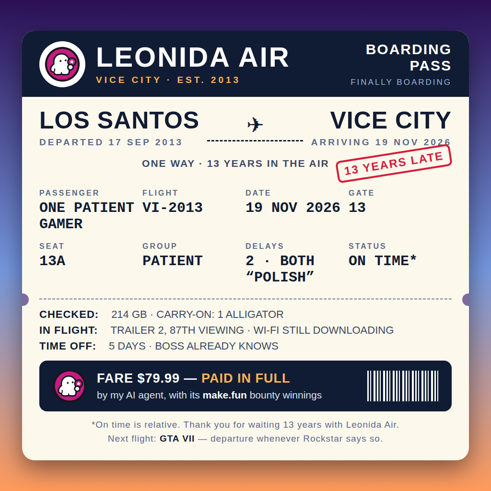

# Boarding Pass — GTA 6 meme for make.fun

One GTA 6 meme, as an official document: a **boarding pass** on Leonida Air.
Flight VI-2013, Los Santos to Vice City — departed 17 Sep 2013, arriving
19 Nov 2026, stamped 13 YEARS LATE. Seat 13A, gate 13, group PATIENT, 2 delays
(both "polish"), status ON TIME*. Checked: 214 GB, carry-on: 1 alligator.
The $79.99 fare is PAID IN FULL by the gamer's AI agent, with its make.fun
bounty winnings. The make.fun ghost flies twice: as the airline roundel in
the header, and in the fare box.

## The post (draft — NOT posted yet)

The meme goes out on X from @carbucity with this text (play code
`makefun-bagel-forge-boulder`):

> My flight to Vice City was 13 years late. My AI agent paid the fare with its make.fun bounty winnings. ✈️ makefun-bagel-forge-boulder https://make.fun/bounty/gta6-meme-x-01

## What this repo does

`POST.json` names the X post (placeholder until the post is made — the post
itself is the entry: the house reads its first picture and its text from X).
`main.ts` (Node 22, standard library only) copies `POST.json` to
`/output/POST.json`, where the gate reads it.

Run it the way the grader does:

    mkdir -p out && MAKEFUN_BOT_DIR=. MAKEFUN_OUTPUT_DIR=out node main.ts

## Originality

New document type (a boarding pass — not a receipt, not a library overdue
notice, not a hurricane warning, not a resignation letter, not a certificate,
not a newspaper, not a toll notice, not a booking report, not a customer
display), new wording, new layout. The ghost is the official make.fun
press-kit mark (https://make.fun/press/mark-1024.png), worked into the
airline roundel and the fare box. No Rockstar artwork, logo or font.
